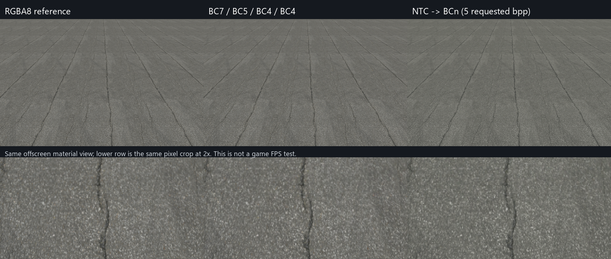

# 道路1材質のBCn / NTC GPU実測

2026-10-27、RTX 4060 Laptop GPU（8188 MiB、driver 610.78）で実施。

後続の [法線BC5固定のハイブリッド調整](RoadTextureHybridExperiment.md) では、色・粗さ・AOのNTC設定を5段階比較し、画質寄りの候補として要求12 bppを選んだ。以下は最初の全マップNTC実験の記録。

**NTCのロード時復元は動作した。今回の道路・設定では、起動速度と画質を優先するなら通常BCnが有利。** NTCは配布データを減らせるが、復元後のGPU容量はBCnと同じで、追加のロード処理と一時メモリが必要だった。

エンジンの提出版を切り替える変更ではなく、同じリポジトリ内の独立したD3D12実験として実装した。実行コードは [RoadTextureGpuTests.cpp](../tests/RoadTextureGpuTests.cpp)、再実行用は [Run-RoadTextureTests.ps1](../tests/Run-RoadTextureTests.ps1)。ゲーム本体の `LoadTexture2D` にNTCやDDSの自動選択はまだ追加していない。

## 実際に動かした経路

対象は `Resources/Textures/PolyHaven/asphalt_02_*_2k.jpg` の色・DirectX法線・粗さ・AOの4枚。各2048×2048、全12 mip。

1. **RGBA8基準**: 現行ローダーと同様にWIC読込→RGBA8→DirectXTexでCPUミップ生成→D3D12転送。色はsRGB、データマップはlinear。
2. **通常BCn基準**: オフラインで色BC7・法線BC5・粗さBC4・AO BC4のDDSを生成。実行時はDDSのブロックをそのままD3D12テクスチャへ転送。
3. **NTC On Load → BCn**: `.ntc`読込→潜在テクスチャ・INT8重み・BC7モードデータの転送→D3D12 Computeで全mip推論→GPU上でBC7/BC5/BC4/BC4化→GPUコピーで最終BCnテクスチャへ格納。

3番は実験コード自身が `libntc.dll` のAPIを呼ぶ。実行時にCLIプロセスを起動したり、復元画像をCPUに戻してBCn化したりはしていない。GPU readbackは計測後の検証用のみ。

[公式SDK v0.10.0-beta](https://github.com/NVIDIA-RTX/RTXNTC/releases/tag/v0.10.0-beta)を使用し、配布ZIPのSHA256を照合した。ソースとライブラリのリビジョンは [inputs.json](Benchmarks/2026-10-27-road/inputs.json) に固定・記録。今回は非CoopVec / GenericInt8経路であり、Tensor CoreによるCoopVecの結果ではない。ドライバー・Developer Mode・電源設定は変更していない。

NTCの学習はオフライン、要求5 bpp、10,000 steps、seed 1234、BC7最適化あり、GDeflateなし。今回のファイルは3,213,460 bytes（SDK表示4.60 bpp）。固定seedでも学習の完全なビット再現性は保証しない。今回使用したNTCのハッシュは [experiment.json](Benchmarks/2026-10-27-road/experiment.json) に保存した。

## 測定結果

初回1回とwarmup 3回を測定対象から外し、その後32回の中央値を取得。ロード時間はファイル読込からGPUフェンス完了までのCPU実時間、GPU時間は同一DIRECTキューのtimestamp query。ファイルキャッシュを消去していない。

| 項目 | JPEG → RGBA8 | 通常BCn DDS | NTC → BCn |
| --- | ---: | ---: | ---: |
| 材質ファイル合計 | 11.82 MiB | 16.00 MiB | **3.06 MiB** |
| 復元後のGPU割当 | 85.50 MiB | **16.125 MiB** | **16.125 MiB** |
| ロード中の所有DEFAULTリソース割当ピーク | 85.50 MiB | 16.125 MiB | **139.56 MiB** |
| UPLOADヒープ | 85.37 MiB | 16.02 MiB | 3.36 MiB |
| ロード実時間 中央値 | 525.04 ms | **12.84 ms** | 38.23 ms |
| ロード実時間 p95 | 557.16 ms | 22.83 ms | 55.04 ms |
| GPU処理合計 中央値 | 67.24 ms | **1.30 ms** | 13.12 ms |
| GPU処理合計 p95 | 67.50 ms | 1.32 ms | 14.26 ms |
| プロセス内の初回ロード実時間 | 461.62 ms | 16.32 ms | **1,624.59 ms** |

NTCのGPU処理内訳の中央値は、転送0.250 ms、推論9.066 ms、BCnエンコード＋GPUコピー3.802 ms。個々の中央値の和は合計の中央値とは一致しない。

初回NTCにはCompute PSOの初期生成を含む。デバイス・NTCコンテキスト生成は全経路で測定前。OS/ドライバーキャッシュを消去していないため、「PCを起動してから初めて開いた場合」の保証値ではない。正式採用時にはPSO事前生成・キャッシュ等の検討が必要。

GPU容量は実機の `GetResourceAllocationInfo` と実際に作成したリソースから集計した割当量。テクスチャの単純なbpp計算や、GPU全体の使用量表示ではない。ドライバー・PSO・ディスクリプタヒープ等は集計外。UPLOADヒープは別掲し、139.56 MiBに加算していない。今回のNTC実装は全mipのRGBA中間画像、各mipのBCブロック出力、コピー用バッファを保持する単純な構成で、一時領域の再利用・タイル化は未実施。

電源モード・クロックは固定していない。CPUミップ生成中のGPUアイドルと、連続Compute時の動的クロックの差を含む、このPC上のロード試験である。経路間の倍率を他GPUやゲーム全体の起動速度へ一般化しない。測定直前の状態は [gpu-environment.csv](Benchmarks/2026-10-27-road/gpu-environment.csv) に記録。

生データ: [gpu.json](Benchmarks/2026-10-27-road/gpu.json)。D3D12デバッグ層でエラー／corruptionなしを確認してから、デバッグ層なしで本測定した。デバッグ測定値は別の [gpu-debug.json](Benchmarks/2026-10-27-road/gpu-debug.json) に保持。

## 画質と描画

全mipをGPUからreadbackしDDSに保存。mip 0の元RGBA8と比較した。PSNRはsRGB色を含め保存された8-bit値上で算出し、色の暗黙のlinear変換を行わない。色はRGB、BC5法線はRG、粗さ・AOはRを比較。元JPEGのSDK側デコードと基準側WICデコードにも丸め差がある。

| mip 0の指標 | 通常BCn | NTC → BCn |
| --- | ---: | ---: |
| 色 PSNR | 43.13 dB | **29.22 dB** |
| 法線RG PSNR | 39.67 dB | **25.61 dB** |
| 粗さ PSNR | 41.93 dB | 32.95 dB |
| AO PSNR | 42.76 dB | 29.25 dB |
| 法線の角度誤差 平均 | 1.71° | **7.68°** |
| 法線の角度誤差 p95 | 3.82° | **15.98°** |

角度誤差はBC5のZを `sqrt(max(0,1-dot(xy,xy)))` で再構成し、正規化した元法線との角度。今回の5 bpp設定は同等画質の比較ではなく、容量を優先した実験設定である。特に道路の細かい凹凸に差があり、このまま提出版へ置き換える判断はしない。数値: [quality.json](Benchmarks/2026-10-27-road/quality.json)。

同じ1024×640のオフスクリーン材質描画も実施。色sRGB・BC5法線のZ再構成・DirectX法線のY向き・粗さ・AOを適用した。各経路に同じ3,000 drawの事前負荷を与えてから32回測定し、単一drawの中央値はRGBA8が0.086 ms、BCnが0.073 ms、NTC復元後が0.075 ms。これは同じ簡易照明・UV・カメラによる材質プレビューであり、ゲーム全体のFPSや実ステージのスクリーンショットではない。



## 採用判断

- **起動速度の改善は通常BCnを先行**する。今回のNTCはウォームロードでも約3倍遅く、PSO未生成の初回も重い。タイトル到達時間の短縮策として優先しない。
- NTCはBCn DDSに対して材質ファイルを約80.8%削減した。ただし通常JPEGに対する削減は約74.1%、さらに同等画質ではない。
- このSDKの `libntc.dll` は約6.65 MiB。道路1材質だけではDLL配布費用も大きい。材質ファイルの削減率を提出ZIP全体の削減率に置き換えない。
- On Load → BCnでは定常GPU容量は通常BCnと同じ。今回の一時割当ピークはRGBA8基準より多く、VRAM削減を目的に採用する構成ではない。
- 次にNTCを詰めるなら、BCnに近い法線画質を得る学習設定、PSOキャッシュ、中間テクスチャとブロック出力の再利用、複数材質でのDLL費用の償却を別々に測る。高速CoopVec経路の値やOn SampleのVRAM削減効果は今回未測定。

## 再実行

Release版DirectXTex静的ライブラリをビルド済みなら、リポジトリのルートで実行する。

```powershell
# この作業環境ではSDK・変換済み素材を取得済み
.\tests\Run-RoadTextureTests.ps1 -ValidateGpu

# SDK・素材から準備する環境（公式SDKのライセンスが適用される）
.\tests\Run-RoadTextureTests.ps1 -AcquireSdk -Prepare -ValidateGpu

# ライブラリが別の出力先にある場合
.\tests\Run-RoadTextureTests.ps1 -DirectXTexLibrary 'path/to/Release/DirectXTex.lib'
```

SDKは `build/ntc/`、`.ntc`・DDS・ログ・その回のJSON・PNGは `tests/out/road-texture/` に生成される。どちらもビルド成果物としてGit管理外。入力4枚のSHA256が変わった場合は `-Prepare` で作り直す。NVIDIA製ハードウェアD3D12アダプターのみを選択し、WARPによる代用は失敗として扱う。提出用exe・Resources・ZIPに実験SDKや素材を自動追加しない。
