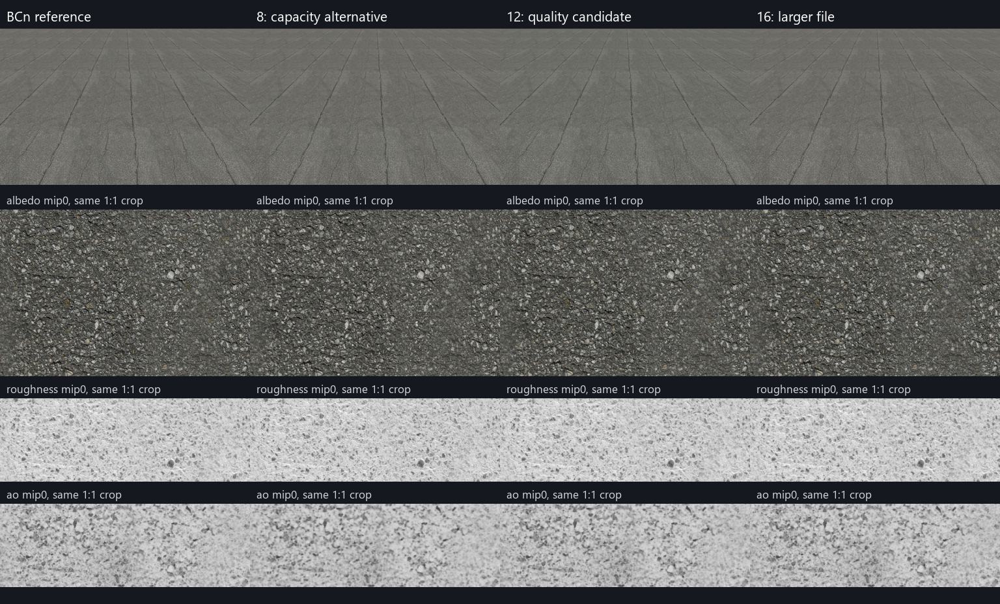

# BC5法線を固定した道路材質のNTC調整

2026-10-27。**画質を優先する候補は要求12 bpp、容量を優先する代案は要求8 bpp。** 12の候補は、法線の追加劣化を避けて、通常BCnに対し材質ファイルを約31%削減できた。色・粗さ・AOは非可逆のため完全無劣化ではない。

道路 `asphalt_02` の色・粗さ・AOだけをNTCへ渡し、法線は元の通常BC5を別ファイルで保持した。[前回の全マップNTC実験](RoadTextureGpuExperiment.md)とは別の追試。要求12の候補は後日ゲーム本体へ採用した（下記「ゲームへの採用」）。

## 条件

- RTX 4060 Laptop GPU、driver 610.78。D3D12実機、非CoopVec / GenericInt8。
- 4マップ各2048×2048、全12 mip。色BC7、法線BC5、粗さ・AO BC4へ最終復元する。
- 法線はNTC学習・推論・再エンコードの対象外。元のBC5 DDSをGPUへ直接転送した。
- 色RGB・粗さR・AO Rを同じNTCセットで学習。要求bppを3 / 5 / 8 / 12 / 16で比較。
- 各30,000 training steps、seed 1234、BC7モード最適化あり、GDeflateなし。bppはSDKへの要求値であり、実ファイルの総bppではない。
- 学習後は独立した検証プログラムで、NTC推論→BCn化→GPUコピーまで実行。CLIの起動時間をロード時間として代用していない。
- D3D12デバッグ層でエラー・corruptionがないことを確認後、デバッグ層なしで、初回＋warmup 3回を除いた32回を測定。デバイス・NTCコンテキスト作成は計測外。

前回の全マップ版は10,000 stepsだった。今回は法線分離と学習回数の変更を両方含むため、前回からの画質向上を法線分離だけの効果とは扱わない。

## 容量と画質

容量には**固定BC5法線約5.33 MiBも含む**。SDK DLLは含まない。PSNRはmip 0を元RGBA8と比較した保存8-bit値の指標で、高いほど近い。色はRGB、粗さ・AOはR。

| 設定 | 材質合計 | 通常BCnからの削減 | 元JPEGからの削減 | 色PSNR | 粗さPSNR | AO PSNR |
| --- | ---: | ---: | ---: | ---: | ---: | ---: |
| 通常BCn | 16.00 MiB | — | JPEGより大きい | 43.13 dB | 41.93 dB | 42.76 dB |
| 要求3 | 7.06 MiB | 55.85% | 40.25% | 29.02 dB | 33.07 dB | 28.40 dB |
| 要求5 | 8.40 MiB | 47.51% | 28.97% | 34.26 dB | 36.03 dB | 31.28 dB |
| **要求8：容量寄り** | **9.28 MiB** | **42.01%** | **21.53%** | 35.95 dB | 36.38 dB | 32.52 dB |
| **要求12：画質寄りの候補** | **11.06 MiB** | **30.85%** | **6.42%** | **39.77 dB** | **37.80 dB** | **36.50 dB** |
| 要求16 | 13.73 MiB | 14.19% | JPEGより16.13%大きい | 40.58 dB | 38.34 dB | 39.34 dB |

**法線は全候補で全12 mipのBC5ブロックが元BC5とバイト一致した。** DDSヘッダーを除く入力BC5、通常BCnのGPU readback、各候補のGPU readbackのペイロードを照合した。法線RG PSNR 39.67 dB、角度誤差平均1.71°／p95 3.82°も全候補で同じ。BC5自体は元RGBA8と完全同一ではなく、NTCによる追加劣化がないという意味である。

要求12は要求8より約1.79 MiB大きくなるが、色とAOのPSNRがそれぞれ約3.8 dB／4.0 dB改善した。一方、12→16は約2.67 MiB増えて、色の改善は約0.8 dB、粗さは約0.5 dB。AOはさらに改善するものの、道路1材質の画質と容量の折り合いとして12を選んだ。これは今回の素材での判断で、別素材へ同じ設定を一律適用する根拠ではない。

## 画像比較

左から通常BCn、要求8、要求12、要求16。上段は同じ簡易照明・UV・視点のGPU材質描画、下段は色・粗さ・AOの同じ位置のmip 0を等倍で切り出したもの。



要求8では色の細かい粒が平滑化される。12では粒やAOの細部をより保ち、16はさらに元に近い。今回の固定視点の描画画像を通常BCnと比較したRGB PSNRは、8が44.23 dB、12が47.06 dB、16が47.93 dB。プレビューの見た目だけでなく各マップも照合して候補を決めた。

この比較は独立した材質プレビューであり、実ステージの移動・照明変化・斜め視点での時間方向の評価は含まない。「ゲーム内で常に差が見えない」とは判断していない。

## GPUロードの実測

| 設定 | ロード実時間 中央値 | GPU処理 中央値 | ロード実時間 p95 | 所有DEFAULT割当ピーク |
| --- | ---: | ---: | ---: | ---: |
| 通常BCn | 12.98 ms | 1.30 ms | 22.72 ms | 16.125 MiB |
| 要求3 | 37.11 ms | 12.25 ms | 47.09 ms | 105.69 MiB |
| 要求5 | 42.86 ms | 10.91 ms | 59.78 ms | 107.00 MiB |
| 要求8 | 37.32 ms | 10.99 ms | 44.05 ms | 108.25 MiB |
| **要求12** | **37.76 ms** | **11.21 ms** | **50.86 ms** | **109.69 MiB** |
| 要求16 | 41.28 ms | 11.43 ms | 48.91 ms | 112.38 MiB |

ロード実時間はファイル読込→GPUフェンス完了まで。法線BC5の読込・転送も含む。GPU時間は同じDIRECTキューのtimestamp query。電源・クロック固定やOSファイルキャッシュ消去はしていないため、他PCやゲーム全体の起動時間へ倍率を一般化しない。要求3の方がGPU処理時間が長い結果も、今回の別潜在形状・動的クロック下での観測値としてそのまま記録した。

最終テクスチャのGPU割当は**全候補とも16.125 MiB**。ピークはリソースの実割当量の合計であり、GPU全体の常駐量やドライバー使用量ではない。UPLOADヒープは別集計。前回から法線用RGBA中間画像とBC5再エンコード領域を省けたが、一時領域のタイル化・再利用はしていない。

このsweepでは同じプロセスで3→5→8→12→16の順に実行し、PSOキャッシュを共有している。最初のNTC初期ロードは約1.37秒だった。後続候補の初回時間を、PSO未生成の初回起動時間とは扱わない。**今回も起動速度は通常BCnが有利で、NTCは主に容量を減らす選択肢。**

材質容量にSDK DLL約6.65 MiBは含めていない。要求12の道路1材質＋DLLだけなら、ZIP圧縮前で約17.71 MiBとなり、通常BCnの16.00 MiBより大きい。複数材質で共有する場合の容量効果や、提出ZIPの実削減率は別の検証が必要。

## ゲームへの採用

2026-10-27、要求12の候補を街ステージの道路材質として採用した。

- 資産: `Resources/Textures/PolyHaven/asphalt_02_material.ntc`（色・粗さ・AO、`hybrid-12` と同一ハッシュ）と `asphalt_02_nor_dx_2k.dds`（元BC5法線）。提出パッケージからは道路のJPEG 4枚を外した。元JPEGは再学習用にリポジトリへ残す。
- 実行時: [RendererNtc.cpp](../Engine/RendererNtc.cpp) の `Renderer::LoadNtcTextureSet` が、本実験と同じD3D12非CoopVec / GenericInt8経路でBCnへ復元する。BC5法線は `LoadTexture2D` のDDS経路でそのまま転送する。法線シェーダーはXYからZを再構成するので、BC5とRGB法線の両方を扱える。
- `libntc.dll` はEXE隣の `NTC/` から読み込む。DLLが無い・GPUがINT8推論に非対応の場合は空を返し、DDS/JPEGへ戻る。提出パッケージには道路JPEGが無いため、その場合の道路は白い無地になる。
- 検証: Release提出パッケージの `--package-smoke` で、ゲーム内で復元した色・粗さ・AOを全12 mip readbackし、本実験の `hybrid-12` readbackとBCnペイロードがバイト一致した。

容量は道路材質＋`libntc.dll`＋ライセンスで、ZIP圧縮後 約13.77 MiB（元JPEG 4枚は約11.82 MiB）。**この1材質だけでは提出ZIPは約1.95 MiB増える。** 代わりに道路のGPU割当はRGBA8の約85.5 MiBからBCnの約16.1 MiBになり、本実験の計測ではロード時間も短い（JPEG→RGBA8 約525 ms、NTC 約38 ms。ただしプロセス初回はPSO生成を含め約1.4秒）。ゲーム全体の起動時間は今回計測していない。

## 保存物と再実行

候補12の実ファイルを `tests/out/road-texture/hybrid-selected/` に保存した。

- `material.ntc`: 色・粗さ・AO。要求12、30,000 steps。
- `normal.dds`: 元BC5法線、全12 mip。
- `selection.json`: 選択した設定と検証範囲。

集計値・入力ハッシュ・各NTCハッシュ・実験コードのハッシュは [summary.json](Benchmarks/2026-10-27-road-hybrid/summary.json)。GPU値は [hybrid-gpu.json](Benchmarks/2026-10-27-road-hybrid/hybrid-gpu.json)、画質は [hybrid-quality.json](Benchmarks/2026-10-27-road-hybrid/hybrid-quality.json)。

```powershell
# SDKと元BCn素材は前回の道路実験で準備済み
.\tests\Run-RoadHybridTests.ps1 -ValidateGpu

# 3マップを5段階で再学習してから実測
.\tests\Run-RoadHybridTests.ps1 -Prepare -ValidateGpu

# 計測完了後、記録・比較画像・候補ファイルを更新（Pillow使用）
python -X utf8 tests/Summarize-RoadHybridTests.py
```

実装は [RoadTextureGpuTests.cpp](../tests/RoadTextureGpuTests.cpp)、sweep実行は [Run-RoadHybridTests.ps1](../tests/Run-RoadHybridTests.ps1)。学習時も実行時も法線をNTCへ混ぜず、GPU readbackの一致を実行スクリプトでも検証する。
