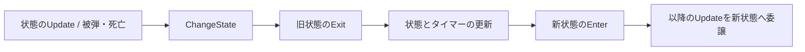

# State Pattern レビューとリファクタリング

## レビューの基準と対象

提供された5枚の授業資料の「状態を表すクラス」「共通関数のオーバーライド」「本体からのポリモーフィックな呼び出し」「状態自身による次状態の決定」を基準に、戦闘の状態管理を確認した。

今回の変更対象は `PlayerActionSystem`、`EnemyAISystem`、`BossActionSystem`、`TickSwarm` の4系統。最後の群れ敵AIは、現在の標準モードである SlimeLife からも使用される。前の3系統は従来のゲームモードで使用される。

## 指摘と対応

いずれも変更前のコードに対する指摘。表に記載した項目は今回の変更で対応した。

| 優先度 | 対象 | 発生条件・問題 | 対応 |
| --- | --- | --- | --- |
| P1 | `BossActionSystem::Update` の Idle / Run / Chase / Attack | 遠距離でジャンプ攻撃を選んでも JumpPress が未登録だと `patterns[-1]` を参照する。近接パターンがない場合も未選択のまま Run に入り得る。選択済みインデックスの上限チェックもない。 | パターン検索・選択を関数化し、未登録なら有効な別パターンで接近する。使用中のパターンが削除・変更された場合は Idle に戻す。 |
| P1 | `CombatSystem::ApplyDamage` / `HealthSystem::Update` とボスの攻撃終了処理 | 部位破壊による Down や死亡で状態だけを直接書き換えると、通常の Attack → Cooldown にしかないビーム破棄が実行されず、攻撃判定が残る。 | `ChangeState` が旧状態の Exit と新状態の Enter を呼ぶ。攻撃終了・ダウン・スタン・死亡・リセットで攻撃判定とビームを後始末する。 |
| P1 | プレイヤーの DecoyWarp / 被弾 / Reset | ワープ開始で `CharacterMovementComponent::enabled` を false にするが、復元は通常着地時だけ。被弾で Stagger に変わると、その後も移動・重力処理が無効のままになる。 | ワープの Enter で元の有効状態を保存し、Exit で復元する。被弾とリセットも同じ経路を使う。 |
| P2 | プレイヤーの Shoot | `stateTimer <= dt * 1.5f` という「初回フレーム」の推測では、短いフレームの次に長いフレームが来た場合、弾の予約とHP消費が再実行される。 | Shoot の Enter で発射済みフラグを初期化し、1回だけ実行する。再入場時には再び1回実行できる。 |
| P2 | `PlayerActionSystem` の入力履歴 | 攻撃・ハンマー・回避の前回入力をSystem全体で共有しているため、複数のプレイヤーを同じSystemで更新すると押下判定が干渉する。 | 入力履歴を各 `PlayerActionComponent` に移す。 |
| P2 | プレイヤーの Stagger | 変形の基準値を毎フレーム設定しないままHP倍率を掛けるため、HPが減っていると、のけぞり中にスケールが毎フレーム縮む。 | Stagger の Update が基準姿勢を設定してから共通のHP倍率を適用する。 |
| P2 | ボスの凍結・泡の解除 | 状態異常中に本体Hitboxを無効にする一方、解除後はビームだけを再有効化している。通常攻撃の途中で凍結すると、残りの攻撃時間に当たり判定が復帰しない。 | Attack継続中は本体とビームの両方を復帰する。命中履歴は維持する。 |
| 設計 | 4系統の状態更新 | 大きな switch / if 列に状態別の処理と遷移先、開始・終了処理が集中している。 | 状態ごとのクラスに Update を分離し、基底インターフェース経由で実行する。開始・終了処理は Enter / Exit に置く。 |

## 実装の構成

- `Engine/IState.h`: `Enter` / `Update` / `Exit` の共通インターフェース。
- `Game/States/PlayerActionStates.inl`: 11状態。攻撃判定の更新、攻撃から回避できる条件も状態側に置く。
- `Game/States/EnemyAIStates.inl`: 6状態。攻撃予告、攻撃開始・終了、スタン色の設定を状態のライフサイクルで実行する。
- `Game/States/BossActionStates.inl`: 9状態。パターン選択、攻撃、ダウン、死亡などを分離する。
- `Game/Chrono/SwarmStates.inl`: 6状態。出現、追跡、予告、突進、回復、死亡を分離する。

System用の `.inl` は対応するSystemのprivate領域に取り込まれる。状態クラスからSystemの生成予約や補助関数を利用でき、これらを外部へ公開する必要がない。

状態オブジェクトは不変の共有インスタンスとし、タイマー・入力履歴・攻撃済みフラグなどは各エンティティのコンポーネントに保持する。更新のたびに状態オブジェクトを確保しない。既存の列挙値、シーンの保存形式、Systemの実行順序、基本的なダメージ値と行動時間は維持している。

外部の被弾・死亡処理は `ChangeState` に割り込みを通知する。通常の次状態は各状態クラスが決める。

ビームは戦闘判定のループ中にも終了し得る。即時にエンティティを破棄するとEnTTの密な配列上の参照・反復を無効化するため、判定・描画・放出を即座に止め、実体の破棄を既存の `CleanupSystem` まで遅延する。フレームの反復外で行うResetでは即時に破棄する。

## 今回クラス化しなかった箇所

- シーン本体の切り替え: 既に `IScene` の仮想関数を `SceneManager` が呼び出し、各シーンが遷移先を要求する構造になっている。
- SceneManagerのCover / Reveal、WaveSystemのPlaying / Clear: 2段階の短い進行処理。資料の単純・少数状態の例外に該当し、現在の表現を維持する。
- AssignmentSceneのIdle / Walking / attack1: 課題のアニメーション補間を確認する小規模な3状態のデモとして維持する。
- Direct3Dリソースの状態、缶・攻撃種類による値の選択: GPU同期やデータ分類であり、キャラクターの行動状態とは役割が異なる。

Chronoの大型ボスの変形・演出、SlimeLifeの本体の取り込み・変形攻撃などは、今回の4系統の変更対象には含めていない。このレポートはプロジェクト内の全状態遷移をState Patternに変換したという報告ではない。

## 検証

`tests/Run-StatePatternTests.ps1` はDebugのアプリ全体をビルドしたうえで、ゲームの実装をリンクしたCPU回帰テストを実行する。描画サービスの初期化なしで、次の経路を検証する。

- プレイヤーのワープ中断、移動状態の復元、液状化終了、リセット。
- 可変dtと複数エンティティでの1回限りの発射、攻撃判定の期間と命中履歴。
- プレイヤーごとの独立した入力履歴と、HP減少時のStagger姿勢の安定。
- 敵の攻撃予告、攻撃、状態異常の停止・復帰、スタン、リセット。
- ボスの攻撃中断・死亡、ビームの遅延破棄、状態異常解除、リセット。
- ボスの未登録・削除された攻撃パターンと不正な選択インデックス。
- CombatSystemの部位破壊とHealthSystemの死亡が共通の状態遷移を経由すること。

群れ敵の通常動作は既存の `tests/Run-ChronoTests.ps1`、SlimeLifeとGPU変形の回帰は `tests/Run-SlimeLifeTests.ps1` で確認する。

2026-10-16の確認結果:

- Debugソリューション全体: 警告0件・エラー0件でビルド成功。検証用の生成先・デバッグ情報・ファイル追跡設定はテストスクリプトで指定し、通常のプロジェクト設定は変更していない。
- `Run-StatePatternTests.ps1 -SkipBuild`: 上記の全体ビルドを使用して、追加した7組すべて通過。
- `Run-ChronoTests.ps1`: 群れ敵を含む既存ルールの回帰テスト通過。
- `Run-SlimeLifeTests.ps1`: SlimeLifeルールと既存のGPU変形・取り込みのテスト通過。
- `Run-EncapsulationTests.ps1`: 既存の公開API・ゲームルールのテスト通過。

ゲーム画面での手動プレイによる視覚・操作の確認は未実施。
