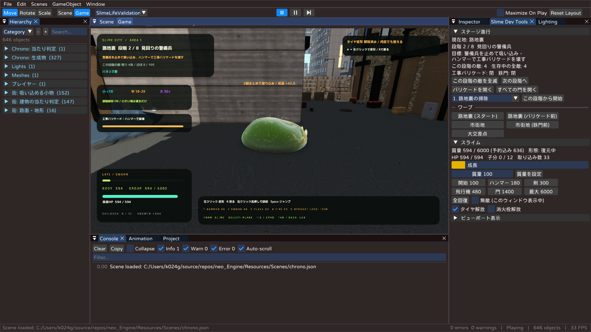
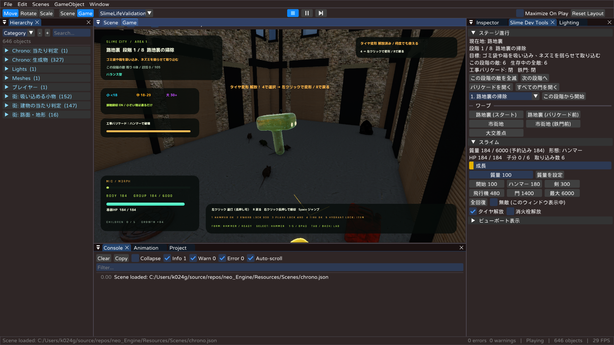

# neo_Engine / スライム、跡で本気出す。

DirectX 12 で作った自作ゲームエンジン **neo_Engine** と、その上で動く 3D アクションゲーム
**「スライム、跡で本気出す。」** のリポジトリです。

スライムを操作して街の小物や敵を取り込みながら大きくなり、ハンマー・剣・飛行機などに体を変形させて戦います。
スライムの体は GPU の流体シミュレーションで動いています。



## 主な特徴

### ゲーム
- **成長と変形**:取り込むほど本体が大きくなり、質量に応じてハンマー・剣・飛行機・タイヤ・消火栓に変形できます。
- **子スライム**:攻撃を受けると体が分かれ、子スライムが自動で戦います。
- **街ステージ**:路地裏 → 大通り → 大交差点の 8 段階で、最後は城砦ゴーレムとの戦いです。
- **強化カードと調合**:ローグライトの強化カードと、出撃前にスライムを作る調合画面があります。

### エンジン
- **描画**:DirectX 12 の描画、HDR ブルーム、GTAO、PBR、ポストエフェクト。対応 GPU では DLSS と RT の影も使えます。
- **GPU 流体**:粒子シミュレーションと、表面の 3D 再構成でスライムを表現します。
- **ECS**:EnTT を使ったエンティティ・コンポーネント・システムと、C++ のスクリプト。
- **エディタ**:Unity 風のエディタ (ImGui)。Hierarchy・Inspector・Scene / Game ビュー・Undo、シーンの JSON 保存があります。
- **データの JSON 化**:調整値・表・画面の文字は JSON で、コードを直さずに変えられます ([Docs/GameData.md](Docs/GameData.md))。



## 動かすには

### 必要なもの
- Windows 10 / 11 (64 ビット) と、DirectX 12 に対応した GPU
- Visual Studio 2022 (「C++ によるデスクトップ開発」、ツールセット v143、Windows 10/11 SDK)

### ビルドと実行
1. `DirectXGame_New.sln` を Visual Studio 2022 で開きます。
2. 構成を選び、`DirectXGameApp` をスタートアップ プロジェクトにして実行します (F5)。

| 構成 | 用途 |
| --- | --- |
| `Development` | 普段の開発用。エディタが付き、検証用のシーンも使えます |
| `Debug` | デバッグ用 (最適化なし) |
| `Release` | 配布用。検証用のシーンは含まれません |

### DLSS について (任意)
DLSS を使う場合は、NVIDIA Streamline SDK を [`scripts/Setup-Streamline.ps1`](scripts/Setup-Streamline.ps1) で配置します。
ライセンスは [Docs/NVIDIA-RTX-SDK-LICENSE.txt](Docs/NVIDIA-RTX-SDK-LICENSE.txt) です。
配置しなくてもゲームは動きます (DLSS が使えないだけです)。

配布用のパッケージの作り方は [Docs/ReleasePackaging.md](Docs/ReleasePackaging.md) を参照してください。

## 操作

| 行動 | キーボード・マウス | Xbox コントローラー |
| --- | --- | --- |
| 移動 | WASD | 左スティック |
| カメラ | マウス | 右スティック |
| 取り込み | 右クリック長押し | X 長押し |
| タックル / 変形中の攻撃 | 左クリック | RT |
| 変形の選択 | 1 ハンマー / 2 剣 / 3 飛行機 / 4 タイヤ / 5 消火栓 | 十字キー左右 |
| スライムに戻る | R | B |
| ジャンプ / 空中で踏みつけ | Space (空中でもう一度) | A (空中でもう一度) |
| 調合画面 | Tab | BACK |
| ポーズ / グラフィック設定 | Esc / F7 | メニューボタン |

エディタの操作 (Ctrl+P で再生と停止など) は [Docs/DevelopmentLog.md](Docs/DevelopmentLog.md) にまとめています。

## フォルダー構成

```
neo_Engine/
├─ Engine/            エンジン本体 (描画・GPU 流体・入力・音・シーン管理・ECS)
├─ Game/              ゲーム
│  ├─ main.cpp        入口 (シーンの登録と起動)
│  ├─ ObjectTypes.h   コンポーネントをまとめて読み込むヘッダー
│  ├─ Components/     ECS のコンポーネント (基本・描画・物理・音・UI・旧アクションゲーム)
│  ├─ Scenes/         タイトル・セレクト・ゲーム・ゲームオーバー・評価課題デモ
│  ├─ Systems/        毎フレームの処理 (ChronoSystem がスライム本編の中心。実装の分担は ChronoSystemInternal.h)
│  ├─ Chrono/         スライム本編のルール (成長・変形・敵・街ステージ・強化カード)
│  ├─ States/         State パターンの状態 (旧アクションゲーム)
│  ├─ Scripts/        C++ のスクリプト
│  ├─ UI/             画面表示 (タイトル・ロード画面・HUD・設定)
│  ├─ Editor/         エディタ (ImGui) と Slime Dev Tools。ウィンドウごとに Editor*.cpp に分割 (一覧は EditorInternal.h)
│  └─ Data/           JSON データの読み込み
├─ Resources/         素材
│  ├─ Data/           調整値・表・画面の文字 (JSON)
│  ├─ Scenes/         シーンファイル (chrono.json が本編)
│  ├─ shaders/        シェーダー (HLSL。起動時にコンパイル)
│  └─ Models/ Textures/ Sound/ Fonts/ Credits/
├─ tests/             単体テストと、ゲームを起動して確かめるスモークテスト
├─ scripts/           素材の取得・配布の作成・DLSS の準備などのスクリプト
├─ externals/         外部ライブラリ (EnTT, ImGui, DirectXTex, nlohmann/json, ufbx, stb など)
└─ Docs/              仕様と設計の資料 (目次は Docs/README.md)
```

### 処理の流れ
`Game/main.cpp` でシーンを登録して `Engine::App` を起動します。
`SceneManager` がタイトル → セレクト → `GameScene` と切り替えます。
`GameScene` は `Resources/Scenes/chrono.json` を読み込み、登録した System を毎フレーム順に動かします。
`GameScene` の実装は、更新 (`GameScene.cpp`)・描画 (`GameSceneDraw.cpp`)・エディタ用の表示 (`GameSceneGizmos.cpp`)・
エンティティの管理 (`GameSceneEntities.cpp`) に分かれています。
スライム本編の処理は `Game/Systems/ChronoSystem.cpp` から始まり、ルールは `Game/Chrono/` にあります。

## テスト

PowerShell で、リポジトリのフォルダーから実行します。

```powershell
# ルールの単体テスト
.\tests\Run-ChronoTests.ps1
.\tests\Run-SlimeLifeTests.ps1

# ゲームを起動して、成長・ステージ進行・UI を確かめるスモークテスト
.\tests\Run-SlimeLifeSmoke.ps1 -Executable <ビルドした DirectXGameApp.exe>
.\tests\Run-SlimeLifeSmoke.ps1 -Executable <ビルドした DirectXGameApp.exe> -ProgressionOnly
.\tests\Run-UISmoke.ps1 -Executable <ビルドした DirectXGameApp.exe>
```

結果と画面の保存は `tests/out/` に出ます (Git の管理対象外です)。

## ドキュメント

詳しい資料は [Docs/README.md](Docs/README.md) に目次があります。まずは次の 3 つがおすすめです。

- [Docs/SlimeLife.md](Docs/SlimeLife.md):現在のゲーム仕様
- [Docs/TDEngine_Technical_Manual.md](Docs/TDEngine_Technical_Manual.md):エンジンの内部構造
- [Docs/GameData.md](Docs/GameData.md):JSON データの一覧と編集方法

## クレジット

音楽は Kevin MacLeod (incompetech.com, CC BY 4.0)、素材は Kenney・Quaternius・Poly Haven (CC0) などを使っています。
素材と外部ライブラリのライセンスは [Resources/Credits/](Resources/Credits/README.md) と、ゲーム内のクレジット画面にまとめています。
